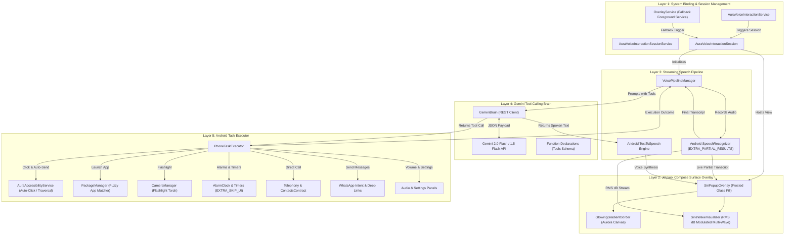

# AuraAssistant Specification & Systems Architecture

> **System Target**: Samsung One UI 5 / 6 / 7 (Android 13 / 14 / 15, API 33–35)  
> **Minimum SDK**: API 29 (Android 10)  
> **Compile / Target SDK**: API 35 (Android 15)  
> **Language / UI Framework**: 100% Kotlin, Jetpack Compose, Material 3, Coroutines & Flow

---

## 1. Architectural Overview

AuraAssistant implements a 5-layer reactive and asynchronous system architecture designed to match and exceed the responsiveness of native OEM assistants (Bixby, Google Assistant, Apple Siri) while providing deep integration into Samsung One UI devices through Gemini Function Calling and Android system services.

---

## 2. Layer-by-Layer Detailed Design

### Layer 1: System Binding & Session Management
- **`AuraVoiceInteractionService`**: Inherits from `android.service.voice.VoiceInteractionService`. Declares `android.permission.BIND_VOICE_INTERACTION` and exposes `@xml/voice_interaction_service`. When designated by the user as the Default Digital Assistant in Samsung One UI (`Settings -> Apps -> Choose default apps -> Digital assistant app`), Android routes system assist triggers directly to this service:
  - Long press of the power / side button (when configured).
  - Swipe up from screen corners (gesture navigation).
  - Wired/Bluetooth headset assistant button clicks.
- **`AuraVoiceInteractionSessionService`**: Generates and manages the lifecycle of `AuraVoiceInteractionSession`.
- **`AuraVoiceInteractionSession`**: Extends `VoiceInteractionSession`. Upon `onShow()`, it inflates a root `ComposeView` into the session window (`getWindow()`). The session window is non-modal (`FLAG_NOT_TOUCH_MODAL`), hardware accelerated, and transparent, leaving the user's running app visible underneath.
- **`OverlayService` (Fallback)**: For users who prefer keeping another assistant default or triggering AuraAssistant via Quick Settings or widget, `OverlayService` runs as a foreground service (`foregroundServiceType="microphone"`) using `WindowManager.LayoutParams.TYPE_APPLICATION_OVERLAY`.

---

### Layer 2: Floating Jetpack Compose Overlay (`SYSTEM_ALERT_WINDOW`)
- **`SiriPopupOverlay.kt`**: Anchored to the bottom of the display with bottom-inset awareness (`WindowInsets.navigationBars`).
- **Visual Features**:
  1. **Aurora Glowing Border**: Animated continuous multi-colour gradient sweep (`Brush.sweepGradient` or animated linear gradient with cyan, violet, magenta, and electric blue) tracing the bottom screen edge and pill perimeter.
  2. **Frosted Glass Capsule**: Dark semi-translucent backdrop (`Color(0xE612131C)`) with subtle surface blur, thin glowing hairline border, and rounded corners (28dp).
  3. **SineWaveVisualizer (`Canvas`)**: 3-wave multi-frequency trigonometric waveform with animated phases ($f(x) = A \cdot \sin(\omega x + \phi)$) whose global amplitude $A$ dynamically scales based on real-time microphone RMS sound levels (`rmsdB` from 0 to 10+).
  4. **Dynamic Card Transitions**:
     - *State: Listening* – Live streaming user transcript with glowing wave pill.
     - *State: Thinking / Executing* – Pulsing aurora indicator and tool execution tag (e.g., "Opening WhatsApp...", "Setting Alarm...").
     - *State: Speaking* – Assistant response text card with quick action badges and auto-dismiss timer.

---

### Layer 3: Streaming Speech Pipeline (STT & TTS)
- **`VoicePipelineManager.kt`**: Coordinates state transitions between listening, thinking, executing, and speaking.
- **Speech Recognition (`android.speech.SpeechRecognizer`)**:
  - Automatically triggered immediately when the overlay becomes visible.
  - Passes `RecognizerIntent.EXTRA_PARTIAL_RESULTS = true` for zero-latency, word-by-word streaming transcriptions.
  - Implements `RecognitionListener`:
    - `onReadyForSpeech`: Signals UI to start the wave visualizer.
    - `onRmsChanged(rmsdB)`: Emits float values to the Compose wave visualizer.
    - `onPartialResults`: Pushes partial token streams to Compose `StateFlow<String>`.
    - `onResults`: Captures final transcript, stops mic, and forwards input to GeminiBrain.
- **Speech Synthesis (`android.speech.tts.TextToSpeech`)**:
  - Speaks Gemini's conversational reply using modern natural TTS voices.
  - Attaches `UtteranceProgressListener` to trigger graceful dismissal of the overlay when speech playback completes.

---

### Layer 4: Gemini API Function Calling Router
- **`GeminiBrain.kt`**: Communicates with the Google Gemini REST API (`gemini-2.0-flash` or `gemini-1.5-flash`) via OkHttp.
- **Function Declarations (Tools Schema)**:
  1. `open_app(app_name: String)`: Finds and launches an installed application.
  2. `make_phone_call(contact_name_or_number: String)`: Direct dialing via phone or contact lookup.
  3. `send_message(app: String, recipient: String, message: String)`: Automates SMS or WhatsApp messages.
  4. `set_alarm_or_timer(type: String, hour: Int?, minute: Int?, duration_seconds: Int?, label: String)`: Sets clock alarms or timers.
  5. `toggle_hardware(setting: String, state: Boolean)`: Controls flashlight, volume, Wi-Fi panel, Bluetooth panel, or DND.
  6. `screen_click_action(target_text: String)`: Clicks on-screen elements via Accessibility.
- **Execution Flow**:
  - Sends user utterance along with system instructions and JSON tool definitions.
  - Inspects `candidates[0].content.parts` for `functionCall`.
  - Dispatches calls to `PhoneTaskExecutor`.
  - Handles conversational fallbacks if no tool call is emitted.

---

### Layer 5: Android Task Executor
- **`PhoneTaskExecutor.kt`**:
  - **Fuzzy App Launch**: Iterates `PackageManager.getInstalledApplications()`, matches user query against label names using normalized Levenshtein / substring logic, and executes `getLaunchIntentForPackage()`.
  - **Direct Telephony**: Queries `ContactsContract.CommonDataKinds.Phone` for closest matching contact name; fires `Intent.ACTION_CALL` (or `ACTION_DIAL` fallback).
  - **WhatsApp & SMS**:
    - Generates `https://wa.me/<number>?text=<encoded_text>` intent or `smsto:<number>`.
    - Coordinates with `AuraAccessibilityService` to automatically find and click the "Send" button in WhatsApp for a hands-free experience.
  - **Alarms & Timers**: Dispatches `AlarmClock.ACTION_SET_ALARM` or `AlarmClock.ACTION_SET_TIMER` with `EXTRA_SKIP_UI = true`.
  - **Hardware Control**:
    - Flashlight: Calls `CameraManager.setTorchMode(id, state)`.
    - Volume: Calls `AudioManager.setStreamVolume()`.
    - Panels: Dispatches `Settings.Panel.ACTION_WIFI` or `ACTION_INTERNET_CONNECTIVITY`.
- **`AuraAccessibilityService.kt`**:
  - Subscribes to window and view state events.
  - Locates clickable nodes using `rootInActiveWindow.findAccessibilityNodeInfosByText()` or `findAccessibilityNodeInfosByViewId()`.
  - Performs `AccessibilityNodeInfo.ACTION_CLICK` on target nodes (e.g. WhatsApp send icon).

---

## 3. Samsung One UI Integration Highlights

1. **Side Key Remap**: One UI natively supports binding the Side Key (Double Press or Press and Hold) to the Default Digital Assistant. Setting AuraAssistant as the assistant allows 1-click invocation from anywhere (lockscreen, gaming, media).
2. **Display Over Other Apps ("Appear on top")**: Guided onboarding screen via `Settings.ACTION_MANAGE_OVERLAY_PERMISSION`.
3. **Accessibility Integration**: Samsung's Knox security requires explicit user activation under `Settings -> Accessibility -> Installed apps -> Aura Assistant`.
4. **Samsung Edge Glow**: The Compose glowing border matches Samsung's Edge Lighting aesthetic, feeling native to Galaxy S22/S23/S24/S25 and Z Fold/Flip devices.

---

## 4. Security & Privacy
- Gemini API Key is stored exclusively on the device using AndroidX `EncryptedSharedPreferences` backed by the hardware Android Keystore (MasterKeys AES-256-GCM).
- Microphone access is only active while the overlay is explicitly in the `LISTENING` state.
- No audio recordings or private contacts data are transmitted to any servers other than direct Gemini API tool calls made with the user's personal API key.
